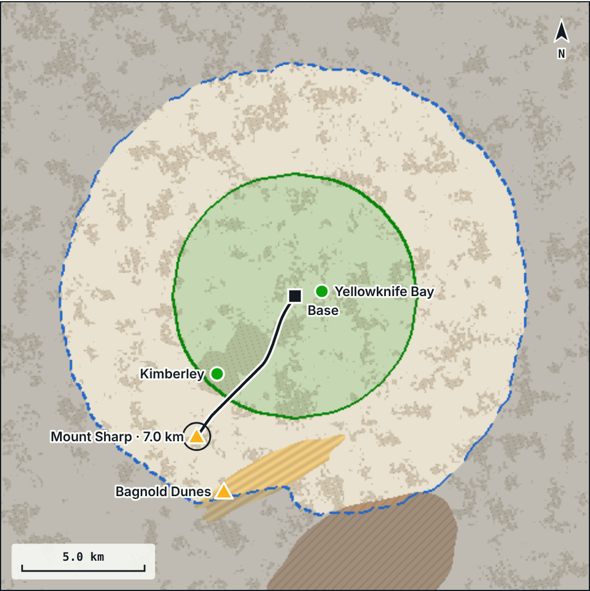
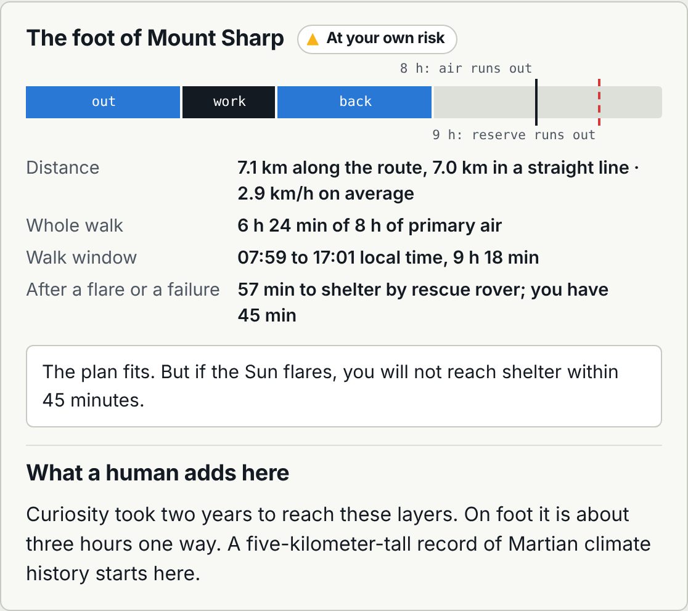
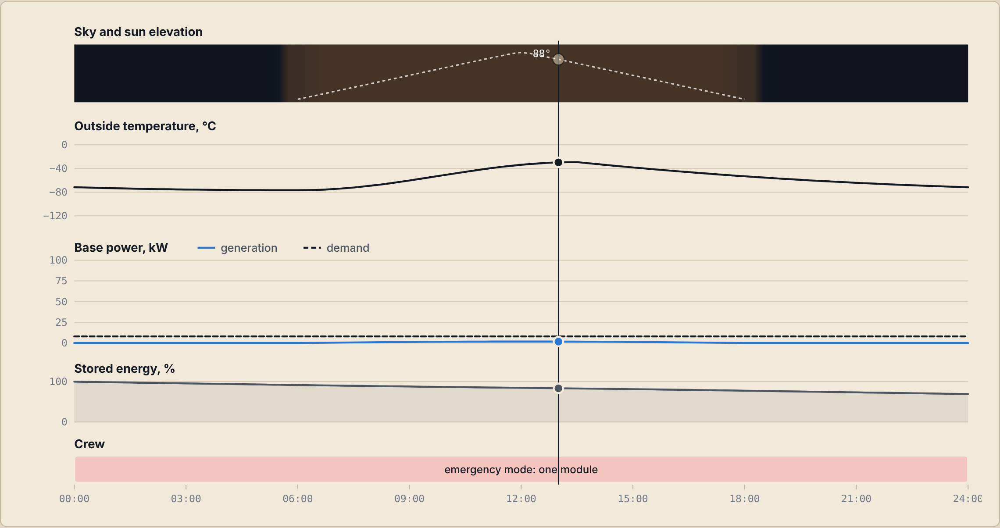

# Worst Sol

**A survival map for the first walks on Mars.** Worst Sol tests a base site, and every walk from it, against its worst day instead of its average one, so a crew knows how far it can go and still get back.

**Live demo:** [https://YOUR-NAME.github.io/worst-sol/](https://YOUR-NAME.github.io/worst-sol/)

Built for the **NASA Space Apps Challenge 2026**, challenge *Interplanetary Survival Guide: Martian Map*.
Top 15 at [Local Event name].



---

## The problem

Maps of Mars show where it is interesting. A crew on a Marswalk needs a different answer: **where can we still get back from when something fails?**

- A spacesuit holds about 8 hours of air.
- A signal to Earth takes 3 to 22 minutes one way, so there is no real-time help.
- Mars has already shown what a bad day looks like. In the 2018 dust storm, Opportunity's solar energy fell from 645 to 22 watt-hours per sol, and the rover went silent. In May 2024, a solar storm gave Curiosity its largest radiation reading of the mission.

## What it does

You pick a base site, switch on a stress test, and every number on the page reacts.

| Part | What you see |
|---|---|
| **Map and vote** | 13 sites: 9 where NASA spacecraft worked, 4 known only from orbit. Basemap: NASA Mars Trek mosaics (MOLA, Viking). Layers: relief, sunlight per sol, near-surface ice. |
| **Four stress tests** | Dust storm (as in 2018), solar flare, reactor failure, missed landing. Plus a season slider. |
| **Marswalk planner** | Ground map around the base (firm ground, rock, sand, slopes, cliffs). The quickest walking route goes around obstacles. A green line marks the zone you can get back from after one failure; a blue line marks the air limit on plan. Every target gets a verdict: **go**, **at your own risk** or **no-go**. |
| **One sol at the base** | Sky, temperature, power produced and used, stored energy and the crew schedule over one sol, plus a 30-sol outlook. |
| **Crowd vs. algorithm** | People vote by instinct, then see how their pick ranks when sites are scored by their weakest link. |
| **Method and sources** | Every value is labeled as measured, computed or estimated, with its source. |

<p>
  
  
</p>

**Example.** At Gale Crater, the walk to the foot of Mount Sharp (7 km) is a **go** on a normal sol. Turn on a solar flare and reaching shelter takes 57 minutes when only 45 are available: the verdict changes to **at your own risk**. At Meridiani, a 2018-class dust storm plus a reactor failure drains the base's stored energy on the fourth sol.

## How it works

1. **Sun and season** from Mars' orbit for each site's latitude.
2. **Dust** reduces solar output as `exp(-0.33 × τ)`, fitted to Opportunity's 2018 record. Check: the model gives 21.5 Wh per sol where Opportunity measured 22.
3. **Routing**: least-time path (Dijkstra) over a terrain grid around the base. Cliffs are impassable; the rescue rover cannot cross sand or slopes.
4. **Safety zone**: from each point, the time to reach air or shelter after one failure, on foot or by rescue rover, compared with the time available.
5. **Site score**: water, winter without the reactor, Marswalks and landing, each 0–100. Worst Sol = half the weakest factor + half the mean.

### Model assumptions

| Parameter | Value |
|---|---|
| Crew | 4 |
| Reactor | 40 kW |
| Base load | 40 kW nominal, 8 kW survival |
| Backup solar | 500 m², 20% efficiency |
| Energy storage | 600 kWh |
| Spacesuit | 8 h primary air + 1 h reserve, 1.5 h of work on site |
| Walking pace | 3.0 km/h on firm ground; ×0.75 on rock, ×0.5 on sand and slopes; ×1.3 when hurrying back |
| Rescue rover | 10 km/h, leaves 15 min after a call |
| Dust storm | halves walking and rover speed |
| Solar flare | 45 min to reach shelter |

These are planning assumptions, not NASA specifications. They are set in one place in the code and can be changed.

## Data and resources

**NASA**
- [NASA Mars Trek](https://trek.nasa.gov/mars/): basemap mosaics (MGS MOLA, Viking MDIM 2.1)
- [Curiosity's proposed path up Mount Sharp](https://science.nasa.gov/resource/curiositys-proposed-path-up-mount-sharp/)
- [Mars 2020 Perseverance raw images](https://mars.nasa.gov/mars2020/multimedia/raw-images/)
- [NASA Worldview](https://worldview.earthdata.nasa.gov/)
- [JPL: Opportunity hunkers down during dust storm](https://www.jpl.nasa.gov/news/opportunity-hunkers-down-during-dust-storm/)
- [NASA: Mars solar storm, May 2024](https://www.nasa.gov/?p=670127)
- [NASA Planetary Data System](https://pds.nasa.gov/)

**Other**
- [USGS Astrogeology: interactive maps of Mars](https://astrogeology-usgs.hub.arcgis.com/pages/interactive-maps-mars)
- [SWIM: Subsurface Water Ice Mapping](https://swim.psi.edu/)

## Limitations

We would rather say this ourselves:

- The ground around each base is a **schematic** drawn from mission reports (dunes, slopes, cliffs placed approximately), not a real slope map.
- Values for the 4 sites without a landing are **estimates**.
- The energy and walking model is a **simplified planning model**, good for comparing sites and scenarios, not for real mission decisions.

## Next steps

- Replace the schematic ground with HiRISE slope and THEMIS thermal-inertia layers for Gale and Jezero.
- Add a rover photo to every walk target.
- A tablet and helmet-display view for use on the surface.

## Use of AI

Claude (Anthropic) was used for ideation, research, writing and debugging code, text, translation, and the slide deck. The app itself contains no AI or machine learning: it runs fixed formulas and a pathfinding algorithm. The team set the goals, checked the facts and results, and published the project.

## Run it

It is a single HTML file with no build step and no backend.

```
git clone https://github.com/YOUR-NAME/worst-sol.git
```

Then open `index.html` in any browser. Without internet the global map falls back to a schematic relief; everything else works. Available in English and Russian.

## Team

| Name | Role |
|---|---|
| [Name] | Team Lead |
| [Name] | [Role] |
| [Name] | [Role] |
| [Name] | [Role] |

---

*Not affiliated with or endorsed by NASA. NASA data is used under NASA's open data policy.*
